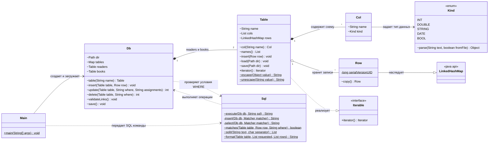

### Файлы
- `Main.java` - консольный интерфейс
- `Kind.java` - типы данных и преобразование значений
- `Col.java` - описание столбца
- `Row.java` - запись таблицы
- `Table.java` - хранение и сериализация таблицы
- `Db.java` - схема базы данных, ключи и операции
- `Sql.java` - обработка запросов

### Таблица `readers` - читатели
| Столбец | Тип | Назначение |
|---|---|---|
| `id` | целое число | первичный ключ |
| `name` | строка | имя читателя |
| `birthDate` | дата | дата рождения, `гггг-мм-дд` |
| `rating` | число с плавающей точкой | рейтинг |
| `active` | логическое значение | активен ли читатель |

### Таблица `books` - книги
| Столбец | Тип | Назначение |
|---|---|---|
| `id` | целое число | первичный ключ |
| `title` | строка | название книги |
| `readerId` | целое число или `NULL` | внешний ключ (`readers.id`) |
| `published` | дата | дата публикации |
| `price` | число с плавающей точкой | цена |
| `available` | логическое значение | доступна ли книга |

### Диаграмма классов


### Хранение данных
По умолчанию создается каталог `data` с файлами `readers.txt` и `books.txt`.
Каждая строка файлов - одна запись, значения разделены символом табуляции. `NULL` записывается как `\N`, обратный слэш, табуляция и перевод строки экранируются. Даты хранятся в формате `гггг-мм-дд`.
После каждой успешной команды данные сохраняются. При запуске существующие файлы загружаются автоматически.

### Запуск
В корне проекта выполнить:
```bash
javac -d out src/*.java
java -cp out Main
```

### Примеры команд
#### Вставка
```sql
INSERT INTO readers VALUES (1, 'Иван Петров', '2000-05-10', 4.5, TRUE);
INSERT INTO books VALUES (101, 'Война и мир', 1, '1869-01-01', 1200.0, TRUE);
INSERT INTO books VALUES (102, '1984', NULL, '1949-06-08', 650.0, TRUE), (103, 'Маленький принц', 1, '1943-04-06', 500.0, TRUE);
```

#### Выбор
```sql
SELECT * FROM readers;
SELECT name, rating FROM readers WHERE rating >= 4.5;
SELECT title, price FROM books WHERE price < 800;
SELECT * FROM books WHERE readerId = 1;
```

#### Обновление
```sql
UPDATE readers SET rating = 4.9 WHERE id = 1;
UPDATE books SET price = 900.0, available = FALSE WHERE id = 102;
```

#### Удаление
```sql
DELETE FROM books WHERE title = '1984';
DELETE FROM readers WHERE id = 3;
```

Правила синтаксиса:

- регистр ключевых слов, имен таблиц и столбцов не важен
- строки заключаются в одинарные кавычки, даты можно также заключать в кавычки
- внутри строки одинарная кавычка записывается как `''`
- поддерживается одно условие `WHERE` с операторами `=`, `!=`, `>`, `<`, `>=`, `<=`
- без `WHERE` операция применяется ко всем записям
- точка с запятой в конце необязательна
